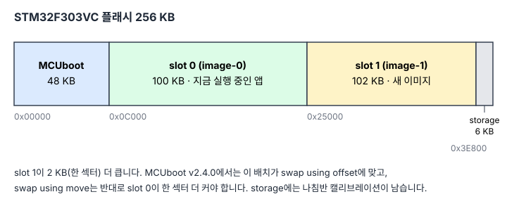
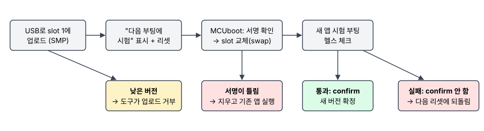

[1편](/posts/2026-09-stm32f3-zephyr-compass/)에서는 STM32F3 Discovery 보드로 기울기 보정 나침반을 만들었습니다. 이번 글에서는 같은 보드에 **안전한 펌웨어 업데이트**를 더했습니다.

- **우리 키로 서명된 펌웨어만 부팅합니다.** 한 바이트라도 바뀐 이미지나 다른 키로 서명된 이미지는 실행하지 않습니다.
- **디버거 없이 USB 시리얼로 업데이트합니다.** 보드의 ST-LINK USB 포트 하나로 콘솔과 업데이트를 함께 씁니다.
- **새 펌웨어는 스스로 정상임을 증명해야 확정됩니다.** 증명하지 못하면 다음 리셋에 이전 펌웨어로 돌아갑니다.
- **업데이트를 해도 나침반 캘리브레이션은 그대로 남습니다.**

현장에 나간 장비는 업데이트 한 번이 실패해도 사람이 직접 가서 고쳐야 합니다. 그래서 업데이트 기능은 "새 펌웨어를 쓰는 것"보다 **"실패해도 장비가 멈추지 않는 것"**이 먼저입니다. 이 글은 그 구조를 작은 MCU에서 실제로 만들고 시험한 기록입니다.

## 구조: 부트로더가 무엇을 실행할지 정한다

MCU의 플래시를 네 부분으로 나눕니다. 맨 앞에 부트로더 **MCUboot**가 있고, 실행 중인 앱이 들어 있는 **slot 0**과 새 이미지를 받을 **slot 1**이 있습니다.



- **MCUboot**는 전원이 켜지면 가장 먼저 실행됩니다. 펌웨어를 내려받는 일은 하지 않고, **무엇을 실행할지만** 정합니다.
- **서명 확인**: 빌드할 때 `imgtool`이 앱 이미지 뒤에 SHA-256 해시와 **ECDSA P-256 서명**을 붙입니다. MCUboot 안에는 공개 키만 들어 있고, 부팅할 때마다 서명을 확인합니다.
- **업데이트**: 앱이 새 이미지를 slot 1에 받고 "다음 부팅에 시험" 표시를 한 뒤 리셋합니다. MCUboot은 서명을 확인하고 두 slot의 내용을 바꿉니다(swap).
- **확정과 되돌리기**: 새 앱은 처음에는 **시험 부팅**입니다. 스스로 확인을 마치고 **confirm**해야 확정되고, confirm하지 않은 채 리셋되면 MCUboot이 두 slot을 다시 바꿔 **이전 앱으로 돌아갑니다**.



1편의 나침반 앱은 거의 그대로 두고, Zephyr의 **sysbuild**로 부트로더와 앱을 한 번에 빌드하도록 바꿨습니다. 서명 키는 저장소에 넣지 않고, 키 파일이 없으면 빌드가 분명한 메시지와 함께 멈춥니다. MCUboot의 예제 키로 서명된 펌웨어가 실수로 나가는 일을 막기 위해서입니다.

| 항목 | 크기 | 한도 |
|---|---|---|
| MCUboot (ECDSA P-256) | 29,108 바이트 | 49,152 바이트 (48 KB) |
| 서명된 앱 (mcumgr 포함) | 87,243 바이트 | 100,352 바이트 (98 KB) |

## "정상"의 기준: 순수 C 함수와 호스트 테스트

새 펌웨어가 무엇을 확인해야 confirm할지는 제품마다 다릅니다. 이 나침반의 기준은 세 가지입니다.

- 센서가 준비되었다.
- 부팅 후 **5초 안에** 유효한 센서 값이 들어왔다.
- 캘리브레이션을 읽을 때 **I/O 오류**가 없었다. 캘리브레이션이 아직 없는 것은 정상으로 봅니다.

이 판단은 Zephyr 헤더를 쓰지 않는 **순수 C 함수**(`lib/health`)로 만들고 PC에서 단위 테스트를 돌립니다. 1편의 나침반 계산과 같은 방식입니다. 보드에서는 이 함수의 결과가 통과일 때만 `boot_write_img_confirmed()`를 부릅니다. 롤백 시연용으로 헬스 체크를 일부러 실패시키는 빌드 옵션(`CONFIG_APP_FAIL_HEALTH`)도 하나 두었습니다.

## USB 업데이트 도구

업데이트는 mcumgr의 **SMP 프로토콜**로 합니다. 앱이 ST-LINK USB 시리얼 포트에서 SMP를 받는데, 같은 포트로 로그도 1초에 한 번씩 나갑니다. 둘이 섞여도 되는지 걱정했지만, 로그가 나오는 중에 슬롯 정보를 20번 읽어 **20번 모두 성공**했습니다.

PC 쪽은 Python 도구 하나(`tools/update.py`, [smpclient](https://github.com/intercreate/smpclient) 사용)입니다.

1. 이미지 헤더에서 버전을 읽고, 지금 실행 중인 버전보다 **높지 않으면 거부**합니다.
2. slot 1에 올리고, 시험 표시를 하고, 리셋합니다.
3. 새 버전이 **confirm될 때까지** 기다립니다.
4. 기다려도 confirm되지 않으면 한 번 더 리셋해서 MCUboot이 되돌리게 하고, **정말 이전 버전이 돌아왔는지 확인**한 뒤 "rolled back"이라고 보고합니다.

결과는 종료 코드로 구분합니다: 0 성공, 2 거부(서명), 3 롤백, 4 다운그레이드 거부, 5 통신 오류.

다운그레이드에는 예외가 하나 있습니다. 다음 글에서 라즈베리 파이가 이 보드를 업데이트하는 게이트웨이가 되는데, 리눅스가 이전 버전으로 롤백되면 **그 리눅스와 함께 시험된 MCU 펌웨어로 되돌려야** 합니다. 그래서 Python API에만 `restore()`를 두고, 명령줄 도구에서는 이 경로를 쓸 수 없게 했습니다.

## 하드웨어에서만 드러난 문제

### MCUboot이 모든 업데이트를 거부했다

처음 플래시하고 부팅하자 앱은 잘 떴지만, 부트로더 로그에 이런 줄이 있었습니다.

```text
Cannot upgrade: not a compatible amount of sectors
```

이 상태로는 **어떤 업데이트도 적용되지 않습니다.** MCUboot 소스의 호환성 검사를 읽어 원인을 찾았습니다.

- 보드의 기본 플래시 배치는 **slot 1이 slot 0보다 한 섹터(2 KB) 큽니다.**
- MCUboot v2.4.0의 **swap using move** 방식은 반대로 **slot 0이 한 섹터 더 커야** 합니다.
- 이 배치는 새 기본값인 **swap using offset** 방식에 맞습니다. 소스 주석에도 "secondary has one more than primary"가 최적이라고 되어 있습니다.

설계 문서에는 예전 기준으로 "swap using move"라고 적어 두었는데, 그 사이 MCUboot의 기본값과 요구 사항이 바뀌어 있었습니다. 플래시 배치는 그대로 두고 방식만 offset으로 바꾸자 경고가 사라지고 업데이트가 동작했습니다. **빌드는 아무 경고 없이 성공했기 때문에, 실제 보드에서 부트로더 로그를 보지 않았다면 모르고 지나갔을 문제**입니다.

### mcumgr가 조용히 꺼져 있었다

mcumgr 옵션을 켜고 빌드했는데, 설정 경고를 자세히 보니 `MCUMGR`가 **켜지지 않은 채** 빌드되고 있었습니다. mcumgr가 쓰는 CBOR 라이브러리(`zcbor`) 모듈이 west 워크스페이스에 받아져 있지 않았기 때문입니다. 1편에서 워크스페이스를 필요한 모듈만 받도록 줄여 두었는데, 그 목록에 `zcbor`가 없었습니다. 목록에 추가하고, UART 전송이 쓸 장치를 devicetree에 지정하자 정상적으로 빌드되었습니다.

### 시험용 "다른 키" 이미지가 다른 이유로 거부될 뻔했다

"다른 키로 서명된 이미지는 거부된다"를 시험하려면, **키만 다르고 나머지는 정상인** 이미지가 있어야 합니다. 처음 만든 스크립트는 서명 옵션이 sysbuild와 달라서 헤더가 두 번 들어갔습니다. 그대로 시험했다면 거부는 되었겠지만 **키 때문이 아니라 이미지 구조가 깨져서** 거부된 것이라 시험의 의미가 없습니다. sysbuild가 실제로 쓴 옵션(헤더 0x200, 정렬 2, slot 크기 104,448)을 빌드 파일에서 확인해 똑같이 맞추고, `imgtool verify`로 "이 키의 서명이 없다"는 결과를 확인했습니다.

## 결과: 실제 보드에서 아홉 가지 시나리오

각 시나리오는 정해진 시작 버전에서 3번씩 돌렸습니다. 6, 7, 8번도 손으로 하지 않고 스크립트로 돌렸습니다(업로드 중 도구 중단, OpenOCD로 정해진 시점에 리셋, 부팅 로그에서 캘리브레이션 값 확인).

| # | 시나리오 | 결과 (3회) | 이후 실행 중인 펌웨어 |
|---|---|---|---|
| 1 | 정상 업데이트 1.0.0 → 1.1.0 | 성공 | 1.1.0 확정 |
| 2 | 서명 후 한 바이트 바꾼 이미지 | 거부 | 1.0.0 그대로 |
| 3 | 다른 키로 서명한 이미지 | 거부 | 1.0.0 그대로 |
| 4 | 헬스 체크가 실패하는 이미지 | 롤백 | 1.0.0 |
| 5 | 도구로 다운그레이드 시도 | 업로드 전 거부 | 그대로 |
| 6 | 업로드 중 도구 중단 후 재시도 | 중단 후 1.0.0 유지, 재시도 성공 | 1.1.0 확정 |
| 7 | swap 중 리셋(0.3 s, 1.0 s, 2.5 s) | 유효한 이미지 하나로 부팅 | 1.1.0 확정 |
| 8 | 업데이트·롤백·복원 후 캘리브레이션 | 매번 같은 값 | - |
| 9 | API로 이전 버전 복원 | 성공 | 1.0.0 확정 |

정상 업데이트 한 번은 업로드부터 확정까지 **약 32초**가 걸렸습니다. 7번은 부트로더 로그를 함께 기록하지 않아서, 각 리셋이 정확히 swap 도중에 들어갔는지까지는 보여 주지 못합니다. 세 번 모두 확정된 이미지 하나로 정상 부팅했다는 것까지가 이번 결과입니다.

## 코드 리뷰에서 찾은 오판

모든 시나리오가 통과한 뒤, 작성자가 아닌 다른 시선으로 전체 코드를 다시 검토했습니다. 그 과정에서 **시나리오로는 드러나지 않은 오판**이 하나 나왔습니다.

- 새 펌웨어가 도구의 대기 시간이 끝난 **직후에** confirm하면, 도구의 두 번째 리셋은 더 이상 되돌리지 못합니다. 보드는 새 버전으로 정상 동작하는데, 도구는 확인 없이 **"rolled back"이라고 보고**하고 있었습니다.
- 지금은 두 번째 리셋 뒤에 실제로 어떤 버전이 확정되어 실행 중인지 읽고, 그에 맞게 성공, 롤백, 또는 통신 오류로 보고합니다.
- smpclient가 던지는 자체 예외 몇 가지가 종료 코드 체계를 빠져나가 프로그램이 그냥 죽던 문제도 함께 고쳤습니다.

업데이트 도구의 보고는 다음 단계(수백 대, 수백만 대)에서 "이 장비가 성공했는가"의 근거가 됩니다. 여기서 틀린 보고는 규모가 커질수록 찾기 어려운 문제가 되므로, 고친 뒤 실제 보드에서 1번과 4번 시나리오를 다시 확인했습니다.

## 이 데모가 보호하지 않는 것

- **키 보호**: STM32F3에는 보안 소자나 암호 가속기가 없어서 공개 키가 부트로더 플래시에 그대로 있습니다. 이 글은 업데이트 흐름을 보여 주는 것이지, 하드웨어 키 보호를 보여 주는 것이 아닙니다.
- **다운그레이드 방지**: 하드웨어 카운터가 아니라 **도구 정책**입니다. 서명이 유효한 옛 이미지를 가진 사람이 USB에 접근하면 다시 올릴 수 있습니다.
- **플래시 읽기·쓰기 보호**를 설정하지 않았고, 이미지 암호화도 쓰지 않았습니다.

실제 제품에서는 보안 부팅을 지원하는 MCU(TrustZone, 보안 키 저장소가 있는 칩), MCUboot의 하드웨어 보안 카운터, 디버그 포트와 플래시 보호를 함께 써서 이 빈틈을 닫습니다.

## 실제 제품이라면

| 제품 | 이번 데모에서 그대로 쓰는 부분 | 제품에서 더 필요한 부분 |
|---|---|---|
| 현장 센서·계측기 | 서명 확인, 시험 부팅과 확정, 자동 롤백 | 보안 키 저장, 하드웨어 다운그레이드 방지, 원격 업데이트 채널 |
| 리눅스 게이트웨이에 붙은 MCU | USB/UART 업데이트 도구와 결과 판정 | 게이트웨이와 MCU 펌웨어의 짝 관리(다음 글) |
| 배터리 장비 | 확정 전까지 이전 이미지 보존 | 배터리 잔량 확인 후 업데이트, 짧은 swap 시간 설계 |

## 다음 글

다음 글에서는 이 보드를 라즈베리 파이 5에 USB로 연결하고, 파이가 **AWS IoT Jobs**로 자신(리눅스 A/B)과 이 MCU를 함께 업데이트하게 만듭니다. 파이의 A/B 업데이트는 [이전 글](/posts/2026-09-pi5-ab-update/)에서, 대규모 배포 설계는 [수백만 대 OTA 글](/posts/2026-09-fleet-ota-design/)에서 다뤘습니다.

MCU 펌웨어의 보안 부팅과 업데이트, 리눅스와 MCU를 함께 업데이트하는 구조가 필요하시면 언제든 연락 주세요.
